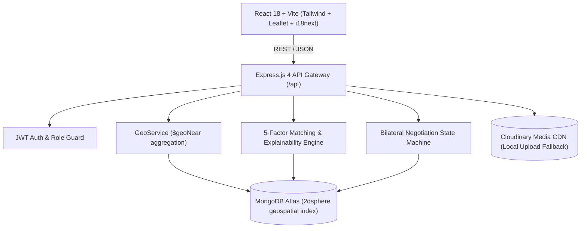

# 🛠️ KaamConnect AI

> **Find the Right Worker. Near You. At the Right Price.**  
> *Hyperlocal, AI-driven discovery and bilateral price negotiation platform for skilled informal blue-collar workers in India.*

---

## 📌 1. Problem Statement

Across India, over **150 million skilled informal trade workers** (electricians, plumbers, masons, carpenters) find work by waiting at physical roadside *labour nakas* or paying 20–30% cuts to traditional aggregator monopolies.

At the same time, households in Tier-2 and Tier-3 cities suffer from:
- **No upfront price transparency**: Quotations vary wildly with zero explanation.
- **Unverified credentials**: Lack of trust in workmanship, reliability, and security.
- **Language barriers**: Most gig apps are built only in English, excluding regional artisans and vernacular-first customers.

---

## 💡 2. Solution: KaamConnect AI

KaamConnect AI bridges local demand and artisan supply through:
1. **Hyperlocal Geospatial Matching**: Powered by MongoDB `2dsphere` geo-indexing and inverse distance scoring.
2. **5-Factor AI Match Engine**: Multidimensional scoring (Skill 30%, Distance 25%, Price 20%, Availability 15%, Bayesian Reputation 10%).
3. **Truth-Grounded Explanations**: Zero AI hallucinations. The rationale explains real data points (exact distance, budget compatibility, specific certifications).
4. **Bilateral Negotiation State Machine**: Customers propose budgets; workers counter-offer freely without algorithmic penalty.
5. **Multilingual Inclusivity**: Full native support for **Telugu (తెలుగు)**, **Hindi (हिंदी)**, and **English (EN)**.
6. **Trust & Privacy Architecture**: Pre-booking mobile number masking, government ID verification, and tamper-proof completed booking reviews.

---

## 🏗️ 3. Architecture Overview



---

## 👥 4. Team Ownership & Monorepo Structure

| Member | Role | Ownership Folders & Scope |
|---|---|---|
| **Member 1** | Frontend Engineering | `client/src/pages`, `components`, `routes`, `styles`, `mocks` |
| **Member 2** | Backend APIs & Auth | `server/src/routes`, `controllers`, `middleware`, `models/User.js`, `services/upload.js`, `utils` |
| **Member 3** | Database & AI Matching | `server/src/models/*` (except User), `services/matching/*`, `services/geo.js`, `seed/*` |
| **Member 4** | Integration, QA, DevOps, i18n | Repo root, `docs/`, `tests/`, `.github/`, `client/src/i18n/*`, deployment, README |

```
kaamconnect-ai/
├── AGENTS.md                      # Antigravity multi-agent pairing contract
├── README.md                      # Product overview and documentation
├── IMPLEMENTATION_PLAN.md         # Master hackathon blueprint
├── render.yaml                    # Full-stack production deployment manifest
├── docs/                          # Shared API contract, data models, matching spec
│   ├── api-contract.md
│   ├── data-models.md
│   ├── matching-spec.md
│   ├── test-plan.md
│   ├── demo-script.md
│   └── pitch-deck-outline.md
├── client/                        # React 18 + Vite + Tailwind frontend
│   ├── src/
│   │   ├── i18n/                  # Member 4 owned (en.json, hi.json, te.json)
│   │   ├── api/                   # Member 1 owned
│   │   ├── components/            # Member 1 owned
│   │   └── pages/                 # Member 1 owned
│   └── vercel.json
├── server/                        # Express 4 + Mongoose backend
│   └── src/
│       ├── app.js                 # Scaffolded Express application
│       ├── server.js              # Server listener
│       ├── config/db.js           # Mongo connector
│       ├── routes/                # Alphabetical route registry
│       ├── models/                # Data models
│       ├── services/matching/     # 5-factor scoring engine
│       └── seed/                  # Idempotent demo seeder
└── tests/                         # End-to-end and integration suites
    ├── api/                       # Supertest integration tests
    ├── postman/                   # Postman collection & environment
    └── e2e-checklist.md           # 12-point sync verification matrix
```

---

## ⚡ 5. Quickstart & Local Setup

### Prerequisites
- Node.js >= 20.x
- npm >= 10.x
- MongoDB Atlas cluster connection string (or local MongoDB with geo index support)

### Installation
```bash
# 1. Clone repository
git clone https://github.com/kaamconnect-ai/kaamconnect-ai.git
cd kaamconnect-ai

# 2. Install all workspaces
npm run install:all
```

### Environment Configuration
1. Server environment:
```bash
cp server/.env.example server/.env
# Edit server/.env and insert your MONGODB_URI and JWT_SECRET
```

2. Client environment:
```bash
cp client/.env.example client/.env
# Default: VITE_API_URL=http://localhost:5000/api
```

### Seeding Demo Data (Centred on Warangal / Kazipet)
```bash
npm run seed
```
> Populates 45 diverse workers, 6 customers, 10 jobs, active bookings, and authentic reviews.

### Running Development Servers
```bash
npm run dev
```
- **Frontend**: `http://localhost:5173`
- **Backend API**: `http://localhost:5000/api`
- **Health Check**: `http://localhost:5000/api/health`

---

## 🔑 6. Demo Accounts

| Role | Email | Password | Details |
|---|---|---|---|
| **Demo Customer** | `customer@demo.com` | `Demo@1234` | Needs ceiling fan and MCB electrical work in Kazipet |
| **Demo Worker** | `worker@demo.com` | `Demo@1234` | Top-rated Electrician (Ravi Kumar), 2.5 km away |
| **Admin** | `admin@demo.com` | `Demo@1234` | ID verification and incident moderation |

---

## 🧪 7. Testing & Verification

```bash
# Run server test suite
npm run test

# Run API health and contract tests
npm --prefix server test tests/api/health.test.js
```

### Postman API Testing
Import `tests/postman/KaamConnect.postman_collection.json` and `tests/postman/KaamConnect.postman_environment.json` directly into Postman to run pre-configured API tests.

---

## 🚀 8. Deployment

- **Backend**: Hosted on Render / Railway (`server/src/server.js`) with automatic health check monitoring at `/api/health`.
- **Frontend**: Hosted on Vercel / Netlify (`client/`) with SPA history API fallback configured in `client/vercel.json`.

---

## 🗺️ 9. Roadmap & Future Scope
- **Voice-Assisted Job Posting**: Speech-to-text in Telugu & Hindi for low-literacy users.
- **Computer Vision Damage Assessment**: Auto-categorization of repair trades from uploaded equipment photos.
- **UPI Escrow Micro-Payments**: Milestones with automated release upon mutual completion confirmation.
- **WhatsApp Bot Interface**: Receive direct booking alerts without needing full smartphone app installation.
